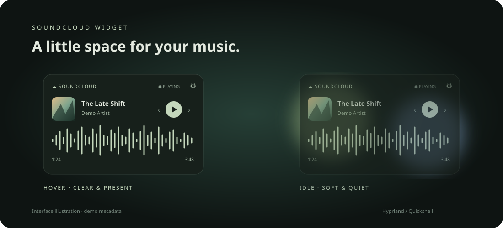
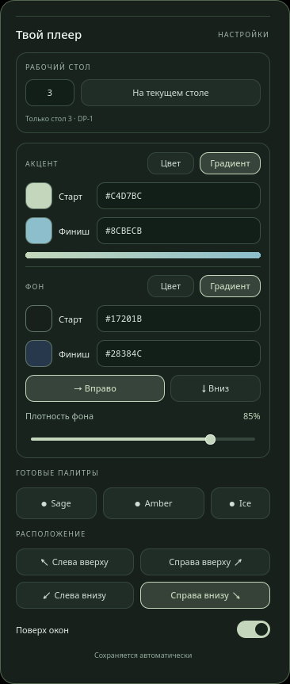
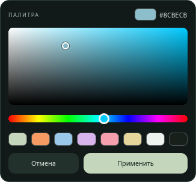

<div align="center">

# SoundCloud Widget

**Your music, one glance away.**

A compact, customizable browser player for Hyprland — with a real audio waveform.

  

[Install](#installation) · [Customize](#make-it-yours) · [How it works](#how-it-works) · [Русский](README.ru.md)



<sub>Interface illustration · demonstration metadata, not a live screenshot.</sub>

</div>

## Small player. Real movement.

- **Live waveform:** actual browser audio, with attack/decay smoothing and animated bars.
- **Quiet when idle:** blur outside the card; a clear background on hover. Opacity follows your Hyprland theme.
- **Your palette:** a built-in HSV picker, HEX input, two-color gradients for the waveform and background, transparency, and Sage / Amber / Ice presets.
- **Your workspace:** pin to one numbered workspace and monitor; the player disappears on other workspaces.
- **Your corner:** four screen corners and an optional layer above windows.
- **Useful controls:** playback, supported track navigation and seeking, plus browser-stream volume.
- **Open and reveal:** the SoundCloud shortcut opens your default browser and focuses its SoundCloud window, including on another workspace. It works even when Hyprland's global `focus_on_activate` is disabled.
- **Local by design:** no API key, account login, microphone capture, or audio uploads.

Built for SoundCloud in your browser. Other browser media sessions can also appear when the browser does not expose the website identity; see [browser behavior](#browser-behavior).

## Installation

### Requirements

A running Hyprland session with its **Lua configuration API**, Quickshell, Python with PyGObject, and a working PulseAudio-compatible audio server, such as PipeWire with its PulseAudio service. The browser must expose an MPRIS media session.

Developed on Hyprland **0.57.2**, Quickshell **0.3.2**, Qt **6.12**, and Python **3.14**. Older releases and legacy `hyprland.conf` configurations are not verified. The supplied integration uses `hl.layer_rule`, `hl.on`, and `hyprctl eval`.

On Arch Linux, install the widget dependencies:

```sh
sudo pacman -S --needed quickshell python python-gobject libpulse
```

`libpulse` supplies `pactl` and `parec`. Keep your existing audio server. For consistent typography, install the Noto Sans font if it is missing.

### ML4W / `require("custom")` layout

```sh
git clone https://github.com/denkach/soundcloud-widget.git
cd soundcloud-widget
python3 install.py --autostart
~/.local/bin/soundcloud-widget start
```

The installer recognizes a `~/.config/hypr/hyprland.lua` that loads `require("custom")`. It installs into your home directory, backs up `custom.lua` before changes, and adds one marked integration block. Repeated installs preserve preferences and avoid duplicate blocks. Existing symlinks to your dotfiles are resolved before editing.

### Other Lua layouts

Install without editing your Hyprland configuration:

```sh
python3 install.py
```

Load the integration **once** from your Hyprland Lua configuration:

```lua
dofile(os.getenv("HOME") .. "/.local/share/soundcloud-widget/hyprland.lua")
```

Then reload and start:

```sh
hyprctl reload config-only
~/.local/bin/soundcloud-widget start
```

The Lua integration provides autostart and the widget's scoped blur rule. A full logout/login autostart cycle has not been tested; direct launch and configuration reload have been verified.

## Make it yours

Click the **gear** in the player, or run:

```sh
soundcloud-widget settings
```

<table>
<tr><th>Appearance settings</th><th>Color palette</th></tr>
<tr>
<td valign="top"></td>
<td valign="top"></td>
</tr>
</table>

<sub>Actual settings components rendered with demonstration preferences. The interface currently uses Russian labels; screenshots contain no playback or account data.</sub>

### 1. Start with a preset

Select **Sage**, **Amber**, or **Ice** under **ГОТОВЫЕ ПАЛИТРЫ**. This sets the accent and background colors and switches both back to solid-color mode. Enable gradients afterward if you want them.

| Preset | Mood |
| --- | --- |
| Sage | Soft green on a deep forest background |
| Amber | Warm highlights and a dark background |
| Ice | Cool blue accents |

### 2. Pick your colors

Use **АКЦЕНТ** for waveform and control colors, and **ФОН** for the card background.

- Select **Цвет** for a solid color. Click its colored square to open the palette.
- Drag the rainbow slider to choose a hue; use the large square to adjust saturation and brightness. The small swatches provide quick choices.
- Click **Применить** to apply your selection or **Отмена** to discard it.
- For an exact color, enter `#RRGGBB` in the field beside the swatch and press Enter or leave the field.

### 3. Build a gradient

Select **Градиент** in the accent or background section. Choose colors for **Старт** and **Финиш** using their swatches or HEX fields.

The accent gradient colors the waveform; other controls use its first color. The background gradient covers the whole card. Use **→ Вправо** for a horizontal background blend or **↓ Вниз** for a vertical one.

To recreate the screenshots:

| Setting | Value |
| --- | --- |
| Accent gradient | `#C4D7BC` → `#8CBECB` |
| Background gradient | `#17201B` → `#28384C` |
| Background direction | **→ Вправо** / horizontal |
| Background density | **85%** |
| Position | **Справа внизу** / bottom-right |

### 4. Adjust transparency and placement

| Control | What it changes |
| --- | --- |
| **Плотность фона** | Background density, from 25% to 100%. Lower values make the background more transparent. |
| **РАСПОЛОЖЕНИЕ** | Choose one of four screen corners with the arrow buttons. |
| **Поверх окон** | Keep the player above regular windows when enabled, or below them when disabled. |
| **РАБОЧИЙ СТОЛ** | Enter the workspace number where the player should appear. |
| **На текущем столе** | Pin the player to your current numbered workspace and monitor. |

While settings are open, the panel temporarily stays above other windows. Close them with the gear to see your chosen stacking behavior. Settings save automatically; no Apply button is needed outside the color picker.

### Focus, blur, and saved preferences

The card also follows Hyprland's `active_opacity` and `inactive_opacity`. These multiply your chosen background density, so an idle card can look more transparent than the slider value suggests. Hover uses one **280 ms, eased animation** for foreground opacity and compositor blur. The foreground stays sharp; reversing hover midway continues smoothly from the current value.

Blur inherits your compositor's settings through the `soundcloud-widget-blur` backdrop. Its size and passes are controlled by your Hyprland theme rather than the color picker.

The player initially pins itself to the current numbered workspace and monitor. Switching workspaces hides it without stopping playback; returning shows it again. Opening settings from the CLI switches to the saved workspace. If the assigned monitor is disconnected, run `soundcloud-widget pin` on an available monitor to recover the player.

Preferences live in `~/.config/soundcloud-widget/settings.json` (the backend also honors `XDG_CONFIG_HOME`). Installed files live in `~/.local/share/soundcloud-widget`; configuration backups live in `~/.local/state/soundcloud-widget/backups`.

## Commands

Use `~/.local/bin/soundcloud-widget` if `~/.local/bin` is not in your `PATH`.

```sh
soundcloud-widget start      # launch without duplicates
soundcloud-widget settings   # open settings
soundcloud-widget toggle     # show / hide on the assigned workspace
soundcloud-widget pin        # pin to the current workspace and monitor
soundcloud-widget status     # inspect current state
soundcloud-widget stop       # stop this widget
soundcloud-widget disable    # stop and remove its managed custom.lua block
```

If you integrated manually, also remove the `dofile(...)` line to disable future autostart. `disable` retains your preferences, installed files, and other Hyprland settings.

### Updating

```sh
git pull --ff-only
soundcloud-widget stop
python3 install.py --autostart
hyprctl reload config-only
soundcloud-widget start
```

For manual Lua integration, omit `--autostart`.

## How it works

```text
Browser MPRIS ── metadata + playback capabilities ──┐
                                                  ├─ Python backend ── Quickshell / QML
Browser audio ── parec stream monitor ── RMS bars ──┘
```

The backend selects a browser's MPRIS session and one matching active audio stream. `parec --monitor-stream` captures that stream through its sink monitor. PCM is processed locally into RMS amplitude bars, with temporal smoothing; QML animates their heights. This is an amplitude visualization, not a frequency spectrum.

The waveform does not capture the microphone or the combined system mix. The widget does not save audio to disk or upload it. Album artwork may use URLs supplied by the browser. The volume slider changes the selected browser stream, not the system master volume.

## Browser behavior

- **Website identity:** SoundCloud is recognized when metadata provides a SoundCloud URL or artwork URL. Otherwise the header honestly reads **BROWSER PLAYER**. Another site, including Twitch, may appear.
- **Playback controls:** next, previous, and seeking depend on the active website's MPRIS capabilities. Unsupported controls are disabled.
- **Multiple streams:** if several matching browser streams are playing, the waveform waits until one remains rather than guessing.
- **Live media:** an unbounded duration is displayed as `LIVE` instead of a huge timestamp.
- **Verification scope:** real Chromium metadata and audio, playback handling, settings persistence, and compositor rule toggling have been checked. A dedicated SoundCloud playback session has not yet been independently verified. Other browsers are recognized by name but are not all tested.

<details>
<summary><strong>Troubleshooting</strong></summary>

**No media?** Start playback in the browser. Check that the website and browser expose MPRIS; only browser sessions are selected.

**No waveform?** Ensure one audio stream from that browser is playing. `pactl --format=json list sink-inputs` can help diagnose the stream; a compatible PulseAudio service must be running.

**No blur or focus effect?** Check that the supplied Lua integration is loaded once and your global compositor blur is enabled. Inspect `hyprctl configerrors`. Legacy Hyprland syntax is not supported by this integration.

**Installer rejects `--autostart`?** Use the manual Lua instructions for your configuration layout. The installer refuses to guess where to edit an unknown layout.

</details>

## Development

```sh
python3 -m unittest discover -s tests -v
/usr/lib/qt6/bin/qmllint -I /usr/lib/qt6/qml app/*.qml
```

The tests cover settings validation, audio stream selection, waveform processing, and safe, repeatable installation into a temporary home directory. They do not replace live compositor/browser testing.

---

<div align="center"><sub>Built for a personal Hyprland desktop. Unofficial; not affiliated with SoundCloud.</sub></div>
