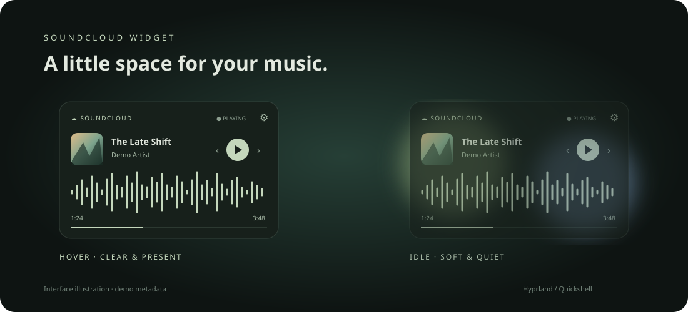

<div align="center">

# SoundCloud Widget

**Музыка всегда под рукой.**

Компактный плеер браузера для Hyprland с настоящей звуковой волной.

[English](README.md) · [Установка](#установка) · [Настройки](#настройки)



<sub>Иллюстрация интерфейса, а не скриншот работающего плеера.</sub>

</div>

## Возможности

- Реальная волна аудиопотока браузера с плавной анимацией.
- Блюр в неактивном состоянии и чёткий фон при наведении; прозрачность из темы Hyprland.
- Встроенная HSV-палитра, HEX, градиенты из двух цветов, прозрачность и пресеты Sage / Amber / Ice.
- Привязка к одному рабочему столу и монитору: на остальных столах плеер скрыт.
- Четыре угла экрана, показ поверх окон, автоматическое сохранение оформления.
- Управление воспроизведением и громкостью потока браузера.
- Кнопка открытия SoundCloud выводит окно браузера на передний план, даже если оно на другом рабочем столе и `focus_on_activate` отключён. Пока ссылка открывается, показывается индикатор; при неудаче — сообщение об ошибке.
- Локальная обработка аудио: без микрофона, записи звука на диск и отправки аудио в сеть.

## Установка

Нужны Hyprland с **Lua API**, Quickshell, Python с PyGObject и работающий PulseAudio-совместимый сервер, например PipeWire с PulseAudio-службой. Браузер должен предоставлять MPRIS.

Среда разработки: Hyprland 0.57.2, Quickshell 0.3.2, Qt 6.12, Python 3.14. Старые версии и конфигурация `hyprland.conf` не проверены. Подробности совместимости — в [английском README](README.md#installation).

Зависимости для Arch Linux:

```sh
sudo pacman -S --needed quickshell python python-gobject libpulse
```

Сохрани свой текущий аудиосервер. Для одинакового отображения шрифтов нужен Noto Sans.

Для ML4W с `require("custom")` в `~/.config/hypr/hyprland.lua`:

```sh
git clone https://github.com/denkach/soundcloud-widget.git
cd soundcloud-widget
python3 install.py --autostart
~/.local/bin/soundcloud-widget start
```

Установщик сохраняет настройки, делает резервную копию `custom.lua` и добавляет один помеченный блок. Повторный запуск не дублирует блок. Остальные настройки Hyprland сохраняются.

Для другой Lua-конфигурации выполни `python3 install.py` без флага и подключи **один раз**:

```lua
dofile(os.getenv("HOME") .. "/.local/share/soundcloud-widget/hyprland.lua")
```

Затем выполни `hyprctl reload config-only` и запусти виджет. Полный выход и повторный вход в Hyprland для проверки автозапуска ещё не выполнялся; прямой запуск и загрузка конфигурации проверены.

## Настройки

Нажми шестерёнку: выбери цвет акцента и фона, прозрачность, угол экрана и показ поверх окон. Цветной квадрат открывает встроенную палитру с выбором оттенка, насыщенности и яркости; поле принимает HEX. Цвет применяется кнопкой «Применить». Изменения сохраняются автоматически.

Режим «Градиент» позволяет выбрать начальный и конечный цвета отдельно для волны и фона. Для фона можно выбрать направление вправо или вниз. Остальные элементы акцента используют первый цвет.

При первом запуске плеер привязывается к текущему рабочему столу и монитору. В настройках можно ввести другой номер или нажать «На текущем столе». На остальных столах плеер скрывается, музыка продолжает играть. Открытие настроек через CLI переключает на назначенный стол. Команда `soundcloud-widget pin` переносит привязку на текущий стол и монитор; она также помогает, если прежний монитор отключён.

Настройки: `~/.config/soundcloud-widget/settings.json`; backend также учитывает `XDG_CONFIG_HOME`. Файлы программы: `~/.local/share/soundcloud-widget`. Резервные копии: `~/.local/state/soundcloud-widget/backups`.

Плеер использует системные `active_opacity` и `inactive_opacity`. При наведении или работе с настройками он активен, иначе затухает и включает блюр. Плотность фона дополнительно умножается на системную прозрачность окна. Размер и проходы блюра берутся из текущей темы Hyprland.

Блюр и прозрачность меняются по одной плавной анимации длительностью **280 мс**. Отдельная подложка `soundcloud-widget-blur` использует `HyprlandWindow.opacity`, чтобы плавно растворять сам системный блюр; текст и кнопки остаются чёткими. При смене наведения посередине переход продолжается из текущего состояния без скачка. Анимация не ждёт опроса музыки или внешних команд.

## Команды

Если `~/.local/bin` отсутствует в `PATH`, используй полный путь.

```sh
soundcloud-widget start      # запуск без дубликатов
soundcloud-widget settings   # настройки
soundcloud-widget toggle     # показать / скрыть на назначенном столе
soundcloud-widget pin        # привязать к текущему столу и монитору
soundcloud-widget status     # состояние
soundcloud-widget stop       # остановить
soundcloud-widget disable    # остановить и удалить свой помеченный блок custom.lua
```

При ручном подключении удали также строку `dofile(...)`, чтобы отключить автозапуск. Настройки и файлы программы сохраняются.

Обновление: `git pull --ff-only`, остановка виджета, повторный запуск установщика, `hyprctl reload config-only` и запуск плеера. Для ручной интеграции не добавляй `--autostart`.

## Что важно знать

- Если браузер не сообщает адрес сайта, заголовок будет **BROWSER PLAYER**. Могут отображаться Twitch и другие вкладки. Виджет не выдаёт их за SoundCloud.
- Перемотка и переключение треков доступны только при поддержке самой вкладкой.
- Когда одновременно играют несколько потоков одного браузера, волна ждёт, пока останется один.
- Бесконечная длительность трансляций отображается как `LIVE`.
- Громкость меняется у выбранного потока браузера, а не у всей системы.
- Волна показывает амплитуду реального PCM, а не частотный спектр. Обложки могут загружаться по адресам из метаданных браузера.
- Проверены реальные данные и аудио Chromium, сохранение настроек и переключение правила блюра. Отдельная проверка именно SoundCloud ещё не завершена; поддержка всех распознаваемых браузеров не гарантируется.

## Проверки

```sh
python3 -m unittest discover -s tests -v
/usr/lib/qt6/bin/qmllint -I /usr/lib/qt6/qml app/*.qml
```

Тесты проверяют настройки, выбор аудиопотока, обработку волны и повторяемую установку во временную домашнюю папку. Инструкции диагностики — в [README](README.md#browser-behavior).

---

Неофициальный проект, не связанный с SoundCloud.
